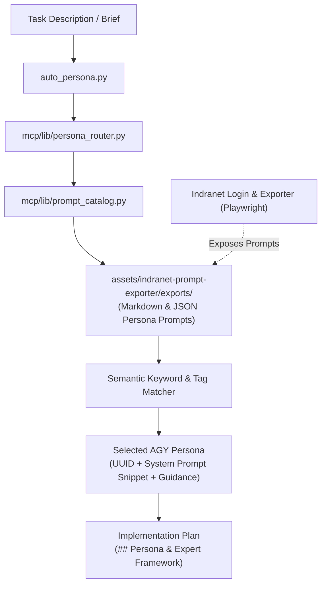

# Codex Handoff: Indranet Prompt Exporter & Persona Router (`assets/indranet-prompt-exporter/`)

> **Target Audience**: AI Coding Assistants (Codex / Antigravity / Claude Code) maintaining persona routing, prompt exports, and MCP tooling.  
> **Repository Location**: `assets/indranet-prompt-exporter/`  
> **Python Path Requirement**: Always prefix commands with `PYTHONPATH=. python3 assets/indranet-prompt-exporter/...` or `rtk proxy python3 ...`.  
> **Timestamp**: 2026-09-16  

---

## 1. Executive Summary & Core Purpose

The **Indranet Prompt Exporter & Persona Router** suite in `assets/indranet-prompt-exporter/` manages the local catalog of exported Indranet persona prompts, automatic task-to-persona routing, offline workstream planning, and Playwright browser prompt harvesting routines.

### Key Operational Rules
1. **Never Commit Credentials / Browser Profiles**: `browser_user_data/` and exported private prompt tokens are strictly `.gitignore`d or protected from public release. Never commit OAuth tokens, cookies, or credentials.
2. **Offline-First Router**: `auto_persona.py` runs 100% locally against `assets/indranet-prompt-exporter/exports/` without requiring live network connections.
3. **Tri-Tier Operating Invariants for Codex**:
   - **Single Inputs**: All single inputs use the best persona for that particular input (instant lookup via `python3 assets/indranet-prompt-exporter/mcp/lib/persona_quick.py "<prompt>"` in ~26ms). Adopt the persona's expert lens, rubric, and tone.
   - **Plans (`/plan`)**: Dual-bind the Role Persona and best matching **INSTRUCTIONS Asset** (`persona_quick.py --plan "<task>"` or `--instructions "<task>"`). Emits `## Persona & Expert Framework`, numbered `## Specific INSTRUCTIONS` grounded in the instruction asset, and DoD. Swarm if multi-disciplinary.
   - **Goals (`/goal`)**: Orchestrate a multi-agent persona swarm. Coordinator adopts a Master INSTRUCTIONS asset (`Instructions - COMPETENCE`, `Instructions - BOOST`, `INSTRUCTIONS - Business Operations`). Workstreams receive dedicated worker personas + worker INSTRUCTIONS assets with write-path isolation and wave execution.

### Exact UUID overrides

An explicit persona UUID is an identity choice, not a ranking hint. Preserve it across tool and prompt workflows, and report an unavailable or unready UUID instead of silently substituting another persona. `persona_quick.py --persona-uuid UUID "<task>"` supports ordinary single inputs; add `--plan` for the persona + INSTRUCTIONS pair, and optionally `--instruction-uuid UUID` to pin the instructions asset. For goals, top-level brief fields `persona_uuid` and `instruction_uuid` select the coordinator; workstream-level fields with the same names select workers. The corresponding `auto_persona.py --plan` CLI flags override the brief's coordinator fields. In natural-language prompts, apply the same rule even when no selector function is invoked.

### Routing evidence and catalog coverage

The router loads standalone prompts from `exports/index.json` and nested version folders. It excludes app introductions, requires strong title, summary, or tag evidence for every recognized task capability, and abstains when no supported capability or ready persona exists. Keep broad capabilities (such as finance or legal) separate from task subtypes when their specialists differ; body-only keyword mentions must not qualify a persona by themselves. Update the offline routing fixtures only after checking both the selected and accepted prompt sources. Current evaluation: `python3 assets/indranet-prompt-exporter/mcp/tests/evaluate_persona_routing.py --split all`.

---

## 2. CLI Execution & Verification Reference

```bash
# 1. Fast Persona Lookup for Single Inputs (<26ms)
rtk proxy python3 assets/indranet-prompt-exporter/mcp/lib/persona_quick.py "troubleshoot mobile overflow"

# 2. Pick Best INSTRUCTIONS Asset Among Persona Assets
rtk proxy python3 assets/indranet-prompt-exporter/mcp/lib/persona_quick.py --instructions "refactor python parser"

# 3. Generate Full Plan with Persona + INSTRUCTIONS Asset Bound
rtk proxy python3 assets/indranet-prompt-exporter/mcp/lib/persona_quick.py --plan "adult schedule section refactor"

# 3a. Pin an exact role and (optionally) exact INSTRUCTIONS asset
rtk proxy python3 assets/indranet-prompt-exporter/mcp/lib/persona_quick.py --plan --persona-uuid PERSONA_UUID --instruction-uuid INSTRUCTION_UUID "adult schedule section refactor"

# 4. Multi-Agent Swarm Execution Plan Brief Mode
rtk proxy python3 assets/indranet-prompt-exporter/mcp/lib/auto_persona.py --plan --brief /path/to/brief.json

# Coordinator may also be pinned with CLI flags or top-level brief UUID fields;
# each workstream can independently specify persona_uuid and instruction_uuid.

# 5. Catalog Audit Mode (Check exports integrity)
rtk proxy python3 assets/indranet-prompt-exporter/mcp/lib/auto_persona.py --audit

# 6. Run Persona Unit Test Suite
rtk proxy python3 -m unittest discover -s assets/indranet-prompt-exporter/mcp/tests -p 'test_*.py'
```

---

## 3. Architecture & Data Flow



---

## 4. Module & Vault Structure

```
assets/indranet-prompt-exporter/
├── exports/                                 # Local vault of exported Indranet persona prompts
│   ├── 2847c3fe-8128-45fa-91c5-ab3dfba20684/ # Dennis Stratton Project Management
│   ├── 4a702064-50b8-4fbb-875c-2f3600c8d6dc/ # Anything-Enhancer - OptiMax
│   ├── 65808004-23a5-42ae-babe-1dbe85bfd1cf/ # Universal Analyzer-Improver
│   ├── index.json                           # Catalog index of all exported prompts
│   └── manifest.json                        # Export provenance manifest
├── mcp/
│   ├── cli.py                               # CLI entrypoint for persona routing
│   ├── server.py                            # FastMCP server exposing persona tools
│   └── lib/
│       ├── auto_persona.py                  # Primary routing script
│       ├── persona_router.py                # Profile loader and tag matcher
│       ├── persona_planner.py               # Bounded multi-agent workstream planner
│       └── prompt_catalog.py                # Index parser and metadata extractor
└── skills/
    └── plan-persona/                        # Skill specification for /plan persona integration
```

---

## 5. Primary Persona Mapping Reference

| Domain / Task Type | Best Matched Persona | Persona UUID | Key Capability / Skillchain |
| :--- | :--- | :--- | :--- |
| Project Management / Governance | **Dennis Stratton** | `2847c3fe-8128-45fa-91c5-ab3dfba20684` | Decision governance, socio-technical alignment, risk transparency |
| Creative Enhancements / Tone | **Anything-Enhancer** | `4a702064-50b8-4fbb-875c-2f3600c8d6dc` | `[EN]` command, creative depth, sensory appeal, narrative resonance |
| Critical Evaluation & Optimization | **Universal Analyzer-Improver** | `65808004-23a5-42ae-babe-1dbe85bfd1cf` | `[STEP]` evaluation, `[cnsd]` synthesis, `[IMP]` iterative enhancement |
| SEO & Local Search | **Solon** | `solon-seo-uuid` | Meta tags, schema, local geo-intent, search ranking strategy |
| Python Engineering & Refactoring | **Pythia** | `pythia-python-uuid` | Clean code, type safety, modular architecture, unit testing |
| Debugging & Error Remediation | **Orko** | `orko-debug-uuid` | Empirical log inspection, root cause tracing, non-superficial fixes |

---

## 6. Backlog & Expansion Guidance for Codex

When Codex works on `assets/indranet-prompt-exporter`:
1. **Adding New Exported Personas**: Place prompt JSON and Markdown files in `exports/<UUID>/` or `exports/<Title>/`, then update `exports/index.json`.
2. **Updating Routing Logic**: Edit `mcp/lib/persona_router.py` to add new tag weights or domain keywords.
3. **Verifying Persona Tests**: Always run `rtk proxy python3 -m unittest discover -s assets/indranet-prompt-exporter/mcp/tests -p 'test_*.py'` after modifying router modules.
